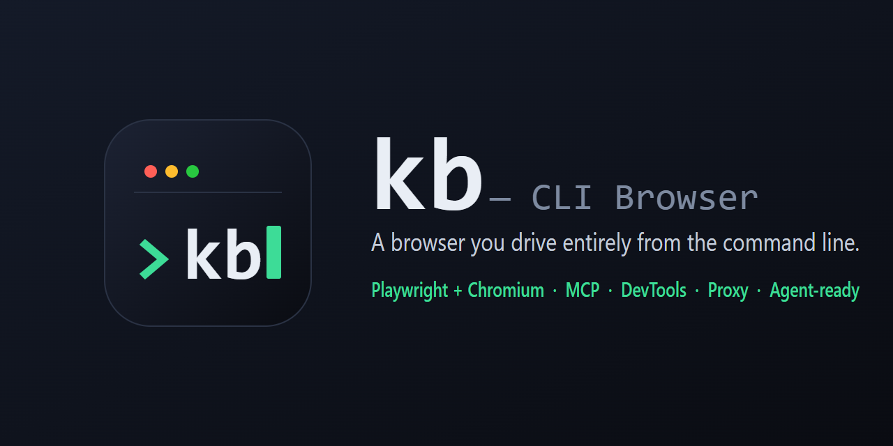

<p align="center">
  
</p>

<p align="center">
  <b>A browser you operate entirely from the command line.</b> Built on Playwright + Chromium (CDP).
</p>

<p align="center">
  <a href="LICENSE"></a>
  = 18">
  
  
</p>

日本語版は [README.ja.md](README.ja.md) を参照してください。

Everything a GUI browser gives you — page rendering, cookie management, DevTools operations (Network / Console / Elements) — is available as `kb` commands. FoxyProxy-style proxy profiles are built in, with **restart-free switching** and per-host routing rules. Designed to be driven by AI agents (Claude Code, etc.) via Bash or MCP, while the window is a real Chrome you can use by hand at any time.

> **Two workflows it's built for:**
> - **Drive it from an AI agent** — Claude Code and other agents operate kb over **MCP (34 tools)** or **Bash** (every command supports JSON action results). The accessibility-snapshot + `--ref` loop is tuned for reliable, low-token automation, and the resident daemon returns each step in tens of milliseconds.
> - **Security research & bug-bounty recon** (authorized testing only) — session-shared HTTP, live network inspection/mocking, raw `eval` on authenticated SPAs, proxy chaining into Burp/Caido, two-account IDOR via profiles, and masked, shareable evidence bundles. See [Security research & bug-bounty recon](#security-research--bug-bounty-recon).

## Features

- **Daemon architecture** — the browser stays resident; every CLI command returns in tens of milliseconds
- **Uses installed Chrome/Edge** — prefers a real browser with DRM support and falls back to bundled Chromium; select with `--channel` or override the UA with `--ua`. Stealth is on by default to reduce basic `navigator.webdriver` exposure, but it does not guarantee Cloudflare production-challenge acceptance. See [Getting past bot checks](#getting-past-bot-checks) for human verification and path continuity
- **Pop a tab into its own window** — `kb tabs detach <id...>` moves one or more tabs into a single new window (or bind a key with `--detach-key`). See [Detaching tabs](#detaching-tabs)
- **Translate the page** — `kb translate` rewrites the page in place like Chrome's "Translate this page" (`--toggle` flips translation ⇄ original, `--text` just prints it, `--translate-key` binds a key). See [Translating a page](#translating-a-page)
- **Attach to a running browser** — `kb daemon start --cdp http://127.0.0.1:9222` connects to a Chrome/Edge started with `--remote-debugging-port` and reuses its signed-in state
- **Chrome extensions** — `kb daemon start --extensions <dir,...>` loads unpacked extensions (`on` enables extensions already installed in the profile, `off` turns it back off). See [Chrome extensions](#chrome-extensions)
- **Agent-optimized** — `kb snapshot` returns an accessibility tree with element refs; `kb click --ref e12` acts on them reliably (including inside iframes), and stale refs are **auto re-resolved** to the element with the same role/name after re-renders. Long outputs (text / html / snapshot) are capped at 20,000 chars by default with `--offset` paging. `kb eval` accepts `await` and multi-line code as-is
- **DevTools from the terminal** — network log / response bodies (`kb net body`) / full headers (`kb net headers`) / request blocking / response mocking (including overriding live endpoints with error responses) / HAR recording / console / DOM inspection
- **Two HTTP paths** — `kb request` is page-independent; `--via-browser` runs a same-origin fetch inside a verified tab, keeping its Cookie, TLS, UA, and Origin path
- **Proxy profiles** — save `host:port` (+auth) as named profiles, switch instantly without restarting the browser, route specific hosts through specific proxies (FoxyProxy-style rules), SOCKS5 auth handled by the built-in relay (the relay itself is token-protected)
- **Headed ⇄ headless / profile switching** — tab URLs are restored; cookies remain isolated and persistent in each profile
- **Persistent sign-in** — log in once and the state is kept in the profile across sessions; `kb login` wraps the manual sign-in flow in one command, `kb storage dump / restore` exports it to a file
- **Operation recording** — commands, network, and console are journaled by default; `kb log export` produces a review/replay bundle (report + steps + request scripts + screenshots) with sensitive values masked by default
- **Human-in-the-loop** — the agent automates, you take over for logins/CAPTCHAs, `kb wait` detects when you're done
- **MCP server** — `kb-mcp` exposes 34 tools (screenshots are returned as images)
- **JSON action results everywhere** — machine-readable output for scripting and agents

## Install

```bash
npm install
npm run build
npm link        # makes kb / kb-mcp available globally
```

The browser binary is auto-selected: installed Chrome → Edge → Playwright's bundled Chromium (run `npx playwright install chromium` only if you need the bundled one).

For every command, argument, option, default, MCP input, and environment variable, see the [complete CLI / MCP reference (Japanese)](docs/CLI_REFERENCE.ja.md).

## Quick start

```bash
kb open example.com        # daemon (browser) auto-starts
kb text                    # read the page as text
kb snapshot                # page structure with element refs
kb click --ref e6          # click reliably by ref
kb screenshot -o s.png
kb daemon stop             # quit the browser
```

Headed (visible window) by default. Cookies and login state persist under `~/.kb/profiles/`.

## Commands

| Category | Commands |
|---|---|
| Daemon | `kb daemon start [--headless] [--profile <n>] [--channel chrome\|msedge\|chromium] [--ua <s>] [--no-stealth] [--detach-key [combo]] [--translate-key [combo]] [--extensions <dirs\|on\|off>] [--cdp <url>] / stop / status` (stealth is on by default) |
| Pages | `kb open <url> [-n] [--wait idle]` / `kb tabs [close/switch <id> / detach <id...>]` / `kb text` / `kb translate [--to ja] [--restore\|--toggle\|--text]` / `kb html` / `kb snapshot` / `kb screenshot [<sel>\|--ref e12] [-f] [--timeout <sec>]` (element-level supported) / `kb pdf` (headless only) |
| Navigation | `kb back` / `kb forward` / `kb reload` / `kb scroll [--to <sel>/--bottom]` |
| Interaction | `kb click` / `kb fill` / `kb select [--label]` / `kb check` / `kb uncheck` / `kb hover` / `kb upload <sel> <local file path...>` / `kb press <key>` / `kb eval <js> [--file f.js]` (`await` & multi-line OK; returns the last expression) — target via CSS selector, `--ref e12` (from snapshot), or `--frame <sel>` (inside iframe) |
| Dialogs | `kb dialog [show]` / `kb dialog accept [text]` / `kb dialog dismiss` / `kb dialog policy [hold\|accept\|dismiss]` (hold `alert`/`confirm`/`prompt`, then respond; default `hold`) |
| HTTP | `kb request <url> [-X POST] [-H "Name: value"] [-d body \| --data-file f] [-o file] [--no-follow \| --follow-verbose] [--via-browser [-t id]]` (page-independent by default; `--via-browser` uses a verified same-origin tab) |
| Login | `kb login [url] [--until <glob>] [--save <file>]` (manual sign-in → state auto-saved to the profile) |
| Account signup | `kb signup bootstrap <name> <url> [--check-url <url>] [--expect-selector <sel>] [--expect-cookie <name>]` / `adopt <name> [--restore-proxy]` / `status [name]` / `checkpoint <name>` (sign up in ordinary Chrome, then adopt the same dedicated profile into kb) |
| Cookies / session | `kb cookies [list/get/set/rm/clear/export/import]` / `kb storage dump` / `kb storage restore <file> [--replace]` / `kb session check <url> [--expect-selector <sel>]` |
| Downloads | `kb downloads [list/clear]` (auto-saved under `~/.kb/downloads/`) |
| Network | `kb net log [-f] [--filter re] [--responses]` / `kb net body <seq>` (response body) / `kb net headers <seq>` (full headers) / `kb net block <glob>` / `kb net mock <glob> [--body f\|--text s] [--status n]` / `kb net unroute <id>\|--all` / `kb net har start/stop` |
| Console | `kb console [-f]` |
| Recording | `kb log [list]` / `kb log start [--name n] [--shots] / stop / status` / `kb log show/steps [--no-mask]` / `kb log export [-o dir]` / `kb log replay [n] [--dry-run]` / `kb log rm <n>` |
| DOM | `kb dom query <sel> [--html] [--attr name] [--frame <sel>]` (falls back to same-name DOM property — value / checked etc. — when the attribute is absent) |
| Proxy | `kb proxy add/rm/list/use/off/status/test` / `kb proxy rule add/rm/list` |
| Mode / profile | `kb mode headed\|headless` / `kb profile list/use <n>` (tab URLs are restored; cookies stay with each profile) |
| Auth | `kb auth set <user> <pass>` / `kb auth clear` (HTTP Basic auth for target sites) |
| Waiting | `kb wait [--url <glob>] [--selector <sel>] [--idle] [--any]` (multiple conditions AND by default, `--any` for OR) |
| Emulation | `kb emulate ua/viewport/tz/geo/net/reset` (net: offline/slow3g/fast3g) |

All command actions support `--json`; pre-action syntax errors remain text on stderr. Long outputs are truncated at 20,000 chars by default; use `--offset <n>` for the next chunk or `--max-chars 0` for everything.

## JS dialogs (alert / confirm / prompt)

Pages that open `confirm` / `alert` / `prompt` on click work too. kb **holds** the dialog open and waits for a response (default `hold`), so the action result carries a `dialog`:

```bash
kb click "#delete"
# → clicked → confirm dialog "Are you sure?" is awaiting a response (tab 1).
#    Respond with kb dialog accept / kb dialog dismiss

kb dialog                 # inspect the pending dialog
kb dialog accept          # OK (confirm → true, prompt → default value)
kb dialog accept "Alice"  # answer a prompt with text, then OK
kb dialog dismiss         # Cancel
```

While a dialog is pending, other actions on that tab (`snapshot` / `text` / `click` …) are guarded and prompt you to respond first. In headed mode the native dialog is shown on screen, so you can click OK / Cancel in the window directly — kb clears its pending state automatically.

To auto-respond instead of holding:

```bash
kb dialog policy accept    # auto-OK every dialog (no display)
kb dialog policy dismiss   # auto-cancel every dialog (the old behavior)
kb dialog policy hold      # back to the default (hold and wait)
```

> Previously Playwright's default dismissed dialogs immediately, making buttons that trigger a `confirm` look like they "did nothing". `hold` fixes this — the dialog is shown to a human and you choose the response.

## Translating a page

Translate the page's text like Chrome's built-in "Translate this page". By default it rewrites the visible text **in place** (layout preserved) and remembers the originals so you can flip back:

```bash
kb translate                 # translate the page to Japanese in place (--to ja by default)
kb translate --restore       # put the original text back
kb translate --toggle        # flip between translation and original (re-uses the cached translation)
kb translate --to en         # translate to a different language
kb translate --text          # don't touch the page — just print the translated text (for reading/agents)
```

Bind a key so you can flip translation ⇄ original in the window with one keystroke:

```bash
kb daemon start --translate-key            # default combo Alt+Shift+T (toggles translate ⇄ original)
kb daemon start --translate-key "Ctrl+J"   # pick your own combo; "off" to disable
```

Single-page apps are handled too: when the site swaps its content without a real page load (soft navigation), `kb translate` / the toggle key notice that the page has effectively changed and translate the new content instead of flipping a stale cache. Repeated text (menus, headers) is cached daemon-wide, so browsing across many pages of the same site only translates what's new.

Translation uses Google's free public endpoint (no key), sent through the browser's proxy. It's unofficial, so very large pages may hit rate limits (kb caps requests, retries once on a rate-limit response, and tells you if part of the page was left untranslated). For a proper API key / provider, `kb translate --text` output can also be piped elsewhere.

## Detaching tabs

Pop one or more tabs into a **single new window** — useful for side-by-side viewing:

```bash
kb tabs detach 3             # move tab 3 into its own new window
kb tabs detach 2 3 5         # move tabs 2, 3, 5 together into one new window
```

Or bind a key to detach the focused tab while you work in the window:

```bash
kb daemon start --detach-key            # default combo Alt+Shift+D
kb daemon start --detach-key "Ctrl+Shift+O"   # pick your own; "off" to disable
```

> Chromium's CDP has no API to *move* an existing tab between windows, so kb re-opens each tab at its current URL in the new window and closes the original. **Only the URL carries over** — in-page JS state, form input, scroll position, and history are not preserved. The key-bound version injects a small page-world listener, so leave it off (`--detach-key off`, the default) when doing strict stealth browsing.

## Getting past bot checks

For normal kb operation, `navigator.webdriver` is hidden via `--disable-blink-features=AutomationControlled`, using your installed Chrome/Edge when available. Cloudflare, however, [does not support solving production challenges in automated browsers](https://developers.cloudflare.com/cloudflare-challenges/reference/supported-browsers/). kb does not promise automated bypass; it supports human verification on authorized targets and keeps the post-verification session coherent.

Keep the **same headed real Chrome, profile, UA, and proxy/IP** before and after Verify. Cloudflare lists mid-flow UA changes, VPN/proxy changes, and extensions among common [challenge-loop causes](https://developers.cloudflare.com/cloudflare-challenges/troubleshooting/challenge-solve-issues/). `kb session check` diagnoses effective UA versus UA Client Hints, custom-UA mismatches, the active proxy, and `cf_clearance` presence/expiry without exposing its value. A clearance cookie can still be re-evaluated; possession alone is not a future-pass guarantee.

```bash
kb login example.com --until-gone "iframe[src*='challenges.cloudflare.com']"   # solve the challenge → it's remembered
kb session check https://example.com/account                                  # diagnose UA/UA-CH, proxy, and challenge
kb request https://example.com/api/me --via-browser                           # use the verified tab's browser path
# or attach to a real Chrome you drive yourself:
kb daemon start --cdp http://127.0.0.1:9222
```

`--via-browser` sends only to the active tab's origin, using that page's `fetch(..., {credentials:'include'})`. Unlike the default `kb request`, which shares the cookie jar but uses a page-independent HTTP stack, this keeps the browser's TLS, UA, Origin, and continuing session path. It does not bypass CSP, CORS, or Fetch restrictions; browser-managed headers such as `Cookie`, `User-Agent`, and `Origin` cannot be supplied manually. It is incompatible with `--no-follow` / `--follow-verbose`, and Fetch does not expose `Set-Cookie` values (the browser still applies them to its cookie jar).

When **account creation itself is blocked** by Cloudflare or a similar service, `kb login` may be too late: the browser is already under Playwright/CDP control. Use the signup handoff flow instead:

```bash
kb daemon stop
kb signup bootstrap target-a https://target.example/signup \
  --check-url https://target.example/account \
  --expect-selector "#account-menu"
# Complete signup, Turnstile, and email/SMS verification in the ordinary Chrome window, then close it
kb signup adopt target-a --restore-proxy
kb signup status target-a
```

`bootstrap` directly launches an installed Chrome (or `--channel msedge`) with a dedicated `signup-<name>` profile. At this stage it uses no Playwright, CDP, remote-debugging, automation, or stealth flags. It also defaults to a **direct** connection (`--no-proxy-server`), keeping Burp/Caido MITM TLS and HTTP/2 fingerprints out of the signup step. Use `--system-proxy` when the OS proxy is required.

`adopt` requires a **post-login URL** such as a dashboard/account page (record it with `bootstrap --check-url`, or pass it to adopt). It opens the same profile under kb and first runs `session check` over the direct connection. A challenge, connection failure, or redirect from the check URL to a login page is not counted as success. Add `--expect-selector` (an element visible only after login) and/or `--expect-cookie` (name only; its value is omitted from check results) as stronger optional evidence.

Only a check satisfying every condition is saved as a Cookie + localStorage checkpoint at `~/.kb/signups/<name>/storage-state.json`. `kb signup checkpoint` re-runs the same checks and never overwrites a known-good checkpoint with degraded state. With `--restore-proxy`, kb restores the proxy that was active before bootstrap, checks again, and rolls back to direct plus the last known-good checkpoint—then verifies the rollback—if the proxy causes a challenge, login redirect, or connection failure.

Close the ordinary Chrome window **normally** before adopting. kb rejects handoff while its daemon or any Chrome child process still holds that profile's `--user-data-dir`, avoiding concurrent use and possible profile corruption. Use `bootstrap ... --reuse-profile` only to resume an existing signup; it preserves the custom profile/channel, original proxy, success conditions, and checkpoint.

Important: an expiry-less **session cookie may be removed or restored when ordinary Chrome closes**, depending on the browser version and session-restore policy. This handoff therefore does not guarantee it. Select “keep me signed in” when available so the site issues a persistent authentication cookie. `--expect-cookie <name>` turns loss into a failed adoption instead of a false success. For targets that never issue persistent cookies, use `kb login`, or `--cdp` when the program rules allow it.

The checkpoint contains login secrets: do not share or commit it. This flow does not bypass challenges automatically; it safely hands off a registration that a human completed normally on an authorized target.

## Staying signed in

**Sign in once.** kb launches the browser with a persistent profile (`~/.kb/profiles/`), so cookies and localStorage survive daemon restarts. For the initial sign-in to a service, use `kb login`:

```bash
kb login github.com          # switches to headed, opens the page → sign in → press Enter
kb login myapp.example.com --until "**/dashboard**"   # auto-detect completion by URL (agent-friendly)
kb login github.com --save gh-state.json              # also back the state up to a file
```

Subsequent sessions start already signed in — nothing to do. A `--save`d file can be carried to another profile or machine with `kb storage restore <file>`.

Note: expiry-less session cookies are subject to the browser's restart/session-restore policy, so persistence across a restart is not guaranteed. `kb storage dump / restore` can explicitly carry state while it is still available. `storage dump` exports **all cookies including HttpOnly** plus localStorage (Playwright storageState format).

To use two accounts at the same time, run a second daemon with its own `KB_HOME` (one daemon = one profile):

```bash
KB_HOME=~/.kb-alt kb daemon start --profile account2   # runs alongside as an independent daemon
```

## Attaching to a running browser

Connect to a Chrome / Edge started with `--remote-debugging-port` instead of launching a new one — its signed-in state, extensions, and settings are used as-is:

```bash
# 1. Start the target browser with CDP enabled (dedicated profile)
chrome --remote-debugging-port=9222 --user-data-dir="%LOCALAPPDATA%\kb-attach"

# 2. Attach kb to it
kb daemon start --cdp http://127.0.0.1:9222
kb tabs                    # existing tabs are visible as-is
kb open myapp.example.com  # everything works as usual from here
kb daemon stop             # disconnects only; the target browser stays open
```

Constraints:

- **Chrome 136+ disables remote debugging on the everyday default profile** (a security change). Start with a dedicated `--user-data-dir` as shown above and sign in to your services there once — the state sticks to that profile.
- Since kb can't change how the target browser was launched, `kb mode` / `kb profile` / `kb auth` are unavailable while attached. Proxy profiles and relay rules can still be saved or switched, but they do not change the already-running attached browser's network path.
- Everything else — open / click / snapshot / eval / screenshot / net log / net body / cookies / storage — works.

## Chrome extensions

Playwright launches Chromium with extensions disabled (`--disable-extensions`) by default; `--extensions` lifts that:

```bash
kb daemon start --extensions "C:\dev\my-extension"      # load unpacked extension(s), comma-separated
kb daemon start --extensions on                         # enable only (use extensions already installed in the profile)
kb daemon start --extensions off                        # back to disabled (the default)
```

- **Unpacked extensions** — point at a directory containing `manifest.json` (`.crx` files are not supported). Handy for developing and testing your own extension.
- **Store extensions** — start with `--extensions on` in headed mode and install from the Chrome Web Store in the window as usual (chrome channel recommended). They persist in the profile, so subsequent starts only need `--extensions on`.
- Like `--channel` / `--ua`, the setting carries over to the next auto-spawn; reset with `--extensions off`.

Constraints:

- **Unpacked extensions load via the bundled Chromium** (when directories are given, channel auto-selection picks bundled Chromium). Chrome 137+ stable removed the `--load-extension` flag, so real Chrome can't load them (`--extensions on` for profile-installed extensions works on any channel).
- Works headless too (the extension-capable new headless mode is selected automatically).
- Mutually exclusive with `--cdp` (attach) — extensions installed in the attached browser itself work as-is.

## API debugging

When your API returns something unexpected, read the body right away — no HAR recording needed:

```bash
kb net log --filter "api"    # note the #seq at the start of each line
kb net body 42               # print that response body (JSON reads as-is)
kb net headers 42            # all request/response headers (cookies, cache-control, …)
```

To see how the UI handles errors, override a live endpoint in place:

```bash
kb net mock "**/api/users" --status 500 --text '{"error":"internal"}'   # matching requests now return 500
kb reload                                                               # inspect the error state
kb net unroute 1                                                        # back to normal
```

Bodies are captured automatically for text-like (JSON / HTML / JS / XML …) XHR / fetch / document responses. Capture is truncated at **256 KB per response** (32 MB / 500 entries total, oldest evicted first): `--offset` pages within the captured part, but anything beyond 256 KB is not recoverable afterwards — if you need the full body of a large response, re-fetch it with `kb request <url> -o <file>`.

To hit an endpoint directly, use `kb request` (a mini REST client):

```bash
kb request localhost:3000/api/users                    # GET
kb request localhost:3000/api/users -X POST -d '{"name":"a"}'   # JSON bodies get Content-Type: application/json automatically
kb request api.example.com/v2/me -H "Accept: application/vnd.api+json" -H "X-Api-Version: 2"
```

Explicit `-H` headers always win (JSON auto-detection only kicks in when Content-Type is unset).

The default page-independent `context.request` path **shares the browser cookie jar and proxy settings**. It is suited to ordinary authenticated APIs, arbitrary origins, and redirect inspection; `Set-Cookie` responses flow back into the browser. Save binary responses with `-o <file>`.

When a Cloudflare-protected endpoint needs the exact path of a verified page, keep that origin open and use `--via-browser`:

```bash
kb open https://app.example.com/account
kb request https://app.example.com/api/me --via-browser          # active tab
kb request https://app.example.com/api/me --via-browser -t 3     # explicit tab
```

This mode is same-origin only and remains subject to CSP, CORS, and Fetch restrictions. The browser supplies `Cookie`, `User-Agent`, `Origin`, `Sec-*`, and similar managed headers, so `-H` cannot override them.

In the default mode, response **`Set-Cookie` headers are shown one per line** (multiple cookies stay parseable instead of being folded together), and `-i` prints all response headers (MCP: `includeHeaders`). With `--json`, `result.setCookies` holds them as an array. Fetch does not expose `Set-Cookie` values in `--via-browser` mode, though the browser still applies them to its cookie jar.

```bash
kb request localhost:3000/api/login -X POST -d '{"user":"a"}'   # Set-Cookie: sid=… is shown above the body
kb request localhost:3000/api/me -i                              # all response headers + individual Set-Cookie
```

The default mode follows redirects. Use `--no-follow` to stop at the 3xx, or **`--follow-verbose`** to print every hop's status / `Location` / `Set-Cookie` (303 and POST-on-301/302 become GET; 307/308 preserve). With `--json`, intermediate hops are in `result.hops`. `--via-browser` cannot combine with either option because browser fetch does not expose redirect-chain headers.

```bash
kb request example.com/login --follow-verbose      # 302 → 301 → 200, each hop with its Set-Cookie
kb request example.com/old-path --no-follow         # show the 3xx itself instead of the final target
```

## Operation recording & shareable bundles

The daemon **records operations by default** (commands, xhr/fetch/document traffic, console output). After a work session, one command produces a self-contained bundle that another person can review and use for replay. Observed traffic is exported as best-effort curl; browser-routed commands retain a kb replay command because curl cannot reproduce browser-managed Cookie, UA, Origin, and TLS state:

```bash
kb log export                 # generates ./kb-log-<session>/
kb log export -o out --no-mask --allow "^cookie$" --deny "internal\.corp"
```

```
kb-log-<session>/
├─ report.md      # numbered steps + per-step network/console + screenshots (start here)
├─ steps.md       # reproduction steps (kb command list)
├─ events.jsonl   # masked journal (machine-readable)
├─ requests/      # curl for normal traffic; the same kb command for browser-routed requests
├─ shots/         # screenshots
└─ meta.json      # session info
```

**Sensitive values are masked by default** (`[MASKED]`): fill inputs, eval return values, Authorization / Cookie headers, password / token-like keys in bodies, and **sensitive keys in URL query strings** (`?api_key=…`, including Location / Referer headers and URLs inside bodies). Unmask with an explicit `--no-mask`; fine-tune with `--allow` / `--deny` (regex). **The local raw journal (`~/.kb/logs/`) is never modified** — masking applies only at export / show time, so reports can be regenerated anytime.

Caveats: `eval` expressions and `net mock --text` arguments are recorded verbatim (masking targets values, not the code you wrote) — use `--deny <regex>` before sharing if you inlined secrets. The **raw journal keeps sensitive values in plaintext**, so always share via export. Old sessions are pruned automatically at daemon start (default: keep 20, configurable via `KB_LOG_KEEP`).

Known limit: values embedded in **URL path segments** (`/verify/<value>` — no key name to detect) are not auto-masked (nested URLs in query strings *are* masked recursively). Use `--deny <regex>` for those.

Sessions split automatically per daemon run, or explicitly with `kb log start --name <n>` (add `--shots` to auto-capture a screenshot after every action — they show up in report.md). Use `kb log show` for recent events and `kb log steps` for a numbered reproduction script.

Recorded operations can be **replayed as-is**:

```bash
kb log replay              # re-run the latest session's actions in order (tab ids map to the active tab)
kb log replay mysession --dry-run          # preview what would run
kb log replay mysession --from 5 --continue-on-error
```

Because replay remaps tab ids to the current active tab, **recordings spanning multiple tabs may not reproduce exactly** (single-tab flows are the target).

## Proxy profiles (FoxyProxy-style)

```bash
kb proxy add work --type http --host 10.0.0.1 --port 8080 --user u --pass p --bypass "*.internal"
kb proxy use work                              # applied instantly, no browser restart
kb proxy rule add "*.corp.example.com" work    # route only this host through work (first match wins)
kb proxy test                                  # verify via external IP + latency
kb proxy status                                # what the daemon is actually using
```

How it works: Chromium always points at a local relay proxy inside the daemon; switching only swaps the relay's upstream. That's why no restart is needed, and why SOCKS5 authentication (which Chromium doesn't support natively) works — the relay handles it. The relay itself requires a per-session token, so other local processes can't ride it.

Common upstream setups:

```bash
# Working behind a corporate proxy (with auth, internal hosts direct)
kb proxy add corp --type http --host proxy.corp.example.com --port 8080 \
  --user myuser --pass mypass --bypass "*.internal,localhost"
kb proxy use corp

# Developing through a local mitmproxy / mock server
kb proxy add local --type http --host 127.0.0.1 --port 8081
kb proxy use local     # applied instantly, no restart
kb proxy off           # back to direct (also instant)
```

When a connection fails (the browser shows `ERR_TUNNEL_CONNECTION_FAILED`), `kb proxy status` lists the recent connection errors (target host, profile used, cause), and they are logged to `~/.kb/daemon.log`.

## Driving it from an AI agent

**From Claude Code, MCP is the recommended way** — native tools, no Bash output parsing:

```bash
claude mcp add kb -- kb-mcp
```

Exposes `kb_snapshot`, `kb_open`, `kb_text`, `kb_translate` (translate the page), `kb_screenshot` (returns an image), `kb_click`, `kb_fill`, `kb_select`, `kb_eval`, `kb_dialog` (respond to alert/confirm/prompt), `kb_tabs_detach` (pop tabs into a new window), `kb_request`, `kb_net_log`, `kb_net_body`, `kb_net_headers`, `kb_proxy_use`, and more — 34 tools.

**Via Bash** everything is available too (after an action starts, commands support `--json` with symmetric `{ok:true,result}` / `{ok:false,error}`; pre-action syntax errors such as a missing required argument remain text on stderr with exit code 1). The recommended loop:

```bash
kb open example.com --wait idle   # use idle for SPAs
kb snapshot                       # discover elements with refs
kb click --ref e12                # act (returns the resulting URL/title)
kb text                           # read the outcome
```

**One-shot actions to cut round-trips**: when the target is identifiable by text, skip the snapshot — Playwright's selector engines work directly:

```bash
kb click "text=Save"                       # text match in one command
kb click "role=button[name='Save']"        # role + accessible name
```

With refs, a ref that went stale after a re-render is auto re-resolved to the element with the same role/name, so you only re-snapshot on failure.

**Human-in-the-loop**: for logins or CAPTCHAs, the user just uses the window directly; the agent resumes after `kb wait --url "**dashboard**"` succeeds. The initial sign-in flow is packaged as `kb login`.

## Security research & bug-bounty recon

kb is a capable driver for **authorized** security testing and bug-bounty reconnaissance — all from the commands documented above:

- **Authenticated API testing / IDOR** — `kb request` shares the browser's cookies and proxy, so you probe authz-protected endpoints as the logged-in user; run two accounts side by side with separate profiles (or two daemons via `KB_HOME`) to diff object access.
- **Runtime recon on SPAs** — `kb eval` runs arbitrary JS in the page context and returns raw values (cookies, tokens, client-side route tables) without redaction — handy for confirming DOM XSS or extracting client config.
- **Traffic inspection & tampering** — `kb net log / body / headers` reads captured requests and responses; `kb net mock / block` rewrites them in place to probe error handling and client-side trust.
- **Proxy chaining** — point kb's upstream at Burp or Caido and route all traffic through your intercepting proxy, switchable without a restart.
- **Attach to a real signed-in session** — `--cdp` reuses a Chrome you signed into by hand (SSO / 2FA / passkey), so real-auth targets work without re-login.
- **Reproducible evidence** — `kb log export` produces a **secret-masked** bundle (report + steps + request scripts + screenshots) you can attach to a report; browser-routed replay uses kb to preserve browser state.
- **Agent-driven, headless** — sub-agents can run recon in parallel against the resident daemon.

> **Test only what you're authorized to.** Follow each program's rules of engagement — many bug-bounty programs prohibit automated scanning, aggressive request rates, or evading their anti-bot / WAF controls. kb is a driver, not a licence: confirm scope and policy first.

## Architecture

```
kb (CLI) ──HTTP+token──▶ daemon ── Playwright persistent context ──▶ Chrome/Edge/Chromium
kb-mcp (MCP stdio) ──┘      └─ local relay proxy (token auth) ──▶ upstream proxies (profiles/rules)
```

State lives in `~/.kb/` (daemon.json / proxies.json / profiles/ / signups/ / downloads/ / daemon.log).

## Development

```bash
npm test        # build + unit tests (node:test, no browser required)
npm run test:e2e  # build + browser e2e smoke (spawns a real daemon in an isolated KB_HOME; auto-skips if no browser)
npm run test:all  # both
```

## License

MIT
