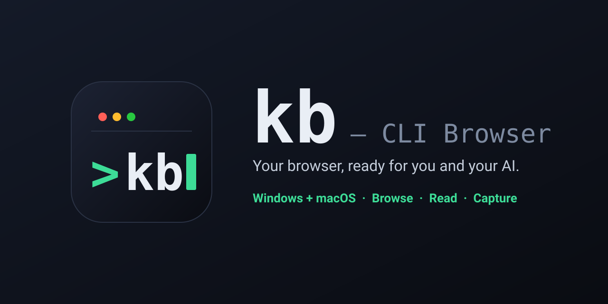

<p align="center">
  
</p>

<p align="center">
  <b>Everyday browser tasks, a few commands away.</b><br>
  On Windows or Mac. Use kb yourself, or let your AI lend a hand.
</p>

<p align="center">
  
  
  <a href="LICENSE"></a>
</p>

<p align="center">
  <a href="#what-you-can-do">What you can do</a> ·
  <a href="#get-started">Get started</a> ·
  <a href="#use-kb-with-ai">Use with AI</a> ·
  <a href="docs/USAGE.md">Usage guide</a> ·
  <a href="README.ja.md">日本語</a>
</p>

**kb lets you control Chrome or Edge with short commands.** Open a page, grab its text, or save a screenshot. The browser tasks you already know are available from your terminal.

A real browser window opens, so you can still use your mouse and keyboard. Connect an AI agent and it can help read pages or handle repetitive steps. You can also use kb entirely through commands, without AI.

**It works on macOS, too.** Windows and Mac use the same source and the same basic commands. kb runs on your Mac itself; no connection to a Windows PC is needed.

## What you can do

| When you want to… | kb can… |
|---|---|
| Use a page's text in your notes or research | Extract the page body as text |
| Keep a record of how a website looks | Save a screenshot of the visible area or the full page |
| Read a page in another language | Translate its text, then restore the original |
| Repeat the same checks | Combine commands to open pages, click, and fill in forms |
| Get help from AI with browser tasks | Let your agent read pages and interact with buttons and fields |

There are also tools for development and investigation, including network inspection and proxy connections. Explore the [usage guide](docs/USAGE.md) when you need them.

## How kb is designed

- **Keep the browser in view.** See what is happening and handle steps such as signing in yourself. You and your AI work in the same window as the task requires.
- **Combine small actions.** `kb open` opens a page; `kb text` reads it. Start with a few commands and add others as you need them.
- **Continue where you left off.** Commands share the running browser, and sign-in data is kept in kb's own storage. This is separate from your everyday Chrome profile, so sign in through kb's window the first time.

kb itself is not an AI. It reads and operates the browser; a connected AI agent handles tasks such as summarizing and deciding what to do next.

## Get started

The first setup happens in a terminal. Open Terminal on your Mac, or PowerShell on Windows.

You will need **Git, Node.js 18 or later (including npm), and Google Chrome or Microsoft Edge**. Use versions that run on your operating system.

### 1. Install kb

Open the folder where you want to keep kb, then run these commands one at a time. The steps are the same on Windows and macOS.

```sh
git clone https://github.com/HiyokoSauna37/kb-browser.git
cd kb-browser
npm ci
npm run build
npm link
```

After `npm link`, you can type `kb` from any folder. Run `kb --version`; if it prints a version number, you are ready.

<details>
<summary>If you see “EACCES” or “permission denied” on a Mac</summary>

If `npm link` cannot write to its installation directory, you can register kb in your user folder instead. Run this from the same `kb-browser` folder:

```sh
npm_config_prefix="$HOME/.local" npm link
export PATH="$HOME/.local/bin:$PATH"
kb --version
```

If you use the default zsh shell, also add `export PATH="$HOME/.local/bin:$PATH"` to `~/.zshrc` so kb is available the next time you open Terminal. You do not need to add the line if it is already there.

</details>

<details>
<summary>If you want to try kb without Chrome or Edge</summary>

Run the following from the `kb-browser` folder to download Chromium for kb:

```sh
npx playwright install chromium
kb daemon start --channel chromium
```

By default, kb tries installed Chrome first, then Edge, then this Chromium. Safari is not a supported browser.

</details>

### 2. Open your first page

Run these commands one at a time, too:

```sh
kb open https://example.com
kb text
kb screenshot -o example.png
```

“Example Domain” opens in the browser, and its text appears in your terminal. The screenshot, `example.png`, is saved in the folder you ran the command from.

You can also interact with the open window by hand. When you are done, close kb's browser with:

```sh
kb daemon stop
```

The “daemon” is the background program that keeps the browser running between commands. For now, you only need to remember this as the command to finish your session.

### 3. Try a few more commands

| To… | Run… |
|---|---|
| Open another page in a new tab | `kb open https://example.org --new` |
| Capture the whole page | `kb screenshot --full -o page.png` |
| Translate the page into Japanese | `kb translate` |
| Restore the original text | `kb translate --restore` |
| List open tabs | `kb tabs` |
| See command help | `kb --help` |

Translation sends the page's text to Google's translation service. For examples of clicking and filling in forms, see the [usage guide](docs/USAGE.md#driving-it-from-an-ai-agent).

## Use kb with AI

Once you connect an AI agent that can operate kb, you can ask for help like this:

> Open this page with kb, summarize its main points, and save a screenshot when you are done.

kb opens the page and passes along the information; the AI reads it and writes the summary. If you need to sign in, you can do that in the browser before letting the agent continue.

If you use Claude Code, connect it after installing kb:

```sh
claude mcp add kb -- kb-mcp
```

MCP is a way for AI to call external tools. kb provides 34 tools through this connection. Agents that can run terminal commands can also call `kb` directly. [More connection and interaction examples](docs/USAGE.md#driving-it-from-an-ai-agent)

## Common questions

### Will it use my existing Chrome sign-in?

By default, kb uses separate storage, so it does not automatically inherit your everyday Chrome sign-in. Sign in through kb's window and that state is saved. You may still need to sign in again when a site expires your session.

### Can Windows and Mac use the same updates?

Yes. Both get updates from the same GitHub repository. Once changes made on Windows have been pushed to GitHub, you can pull them onto your Mac. From the `kb-browser` folder on each computer, run these commands one at a time. If a command reports an error, stop and check it before continuing.

```sh
git pull --ff-only
npm ci
npm run build
```

If kb is running, finish your current work and run `kb daemon restart` to apply the update. Save any tab URLs and unfinished form entries you need before restarting. Browser sign-in data and settings are stored on each computer and do not sync automatically.

### Where is my data stored?

Sign-in data, settings, and operation logs live in the `.kb` folder inside your user folder. Operations are logged by default, and those logs can contain input values and authentication details. To share a log, use `kb log export` and review the exported content first.

When you connect an AI agent, operation results such as page text and screenshots are passed to that AI.

### Does it work on Linux?

There is also a Linux implementation, with unit tests checked under WSL. This README focuses on setup for Windows and macOS. See the [development notes](CLAUDE.md) for browser libraries and other Linux setup details.

## Explore further

- [Usage guide](docs/USAGE.md) — clicking, typing, translation, sign-in, AI connections, network inspection, proxies, and more.
- [Complete CLI / MCP reference (Japanese)](docs/CLI_REFERENCE.ja.md) — every command, option, and environment variable.
- [Development and internals (Japanese)](CLAUDE.md) — how kb uses Playwright and Chromium, plus build and test instructions.

License: [MIT](LICENSE)
